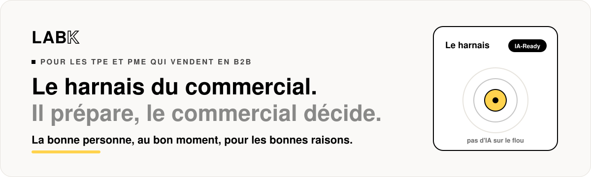
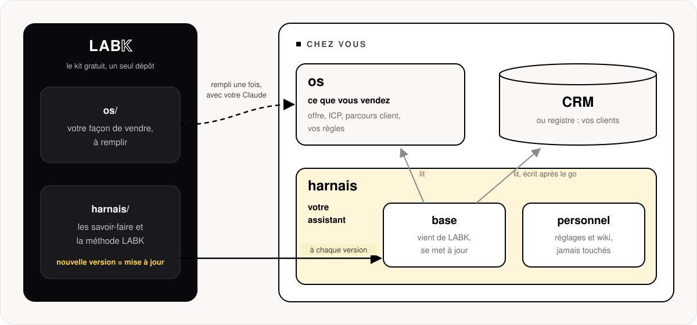
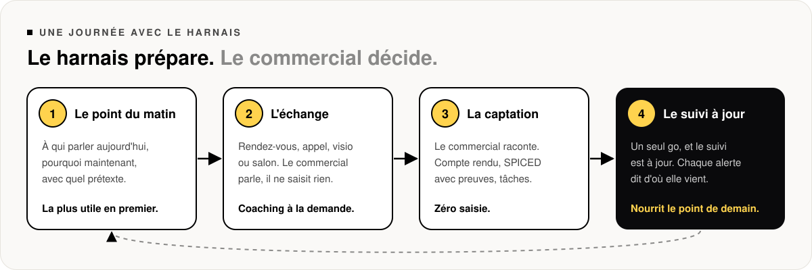

---

## Ce que c'est

Voici le premier harnais de la série LABK. Un harnais, ici, c'est un assistant de vente qui s'installe dans votre Claude : des règles, une méthode et une mémoire, rangées dans un dossier de votre ordinateur. Il est gratuit et prêt à l'emploi.

Il est pensé pour ceux qui vendent eux-mêmes ce qu'ils font : freelances, consultants, agents commerciaux, dirigeants de petites entreprises. Vous n'avez pas besoin de connaître une méthode de vente pour vous en servir : il vous l'apprend en chemin, un point à la fois.

Le travail qui reste est le vôtre : lui dire ce que vous vendez, à qui, et où en sont vos prospects. Il vous le demande question par question, à l'installation.

## Pourquoi un harnais

Claude ne connaît ni vos clients ni votre façon de vendre, et il ne garde pas de lui-même, d'une conversation à l'autre, où en est chacune de vos affaires.

Le harnais lui donne ce qui lui manque. Il garde par écrit où en est chaque affaire, ce que le client a vraiment dit, et ce que vous lui avez appris. Comme en montagne, il ne grimpe pas à votre place. Il vous retient quand vous glissez, et il vous permet d'aller plus haut.

Ce que vous vendez, à qui, et les étapes de vos ventes s'écrivent dans un second dossier, que LABK appelle l'OS : c'est votre façon de vendre, mise par écrit, et corrigée quand vos affaires la contredisent. Le harnais la lit chaque jour, et vous la remplissez avec lui à l'installation.

## Il est à vous, et il vous suit

Le harnais devient votre mémoire commerciale : tout ce qu'il sait de vos clients, de vos affaires et de votre façon de vendre est écrit dans des fichiers texte, dans un dossier qui vous appartient. Rien n'est enfermé dans un logiciel.

Il est donc transportable. Vous pouvez copier ce dossier, le sauvegarder ou le changer d'ordinateur, et votre mémoire part avec lui. Vous pouvez aussi le brancher sur une autre IA que Claude.

## Pourquoi ce projet existe

Vendre est devenu plus dur. Les prospects ne disent plus non, ils cessent de répondre. Les décisions traînent, et beaucoup d'affaires finissent dans le statu quo. Alors on garde tout ouvert, par peur de rater la bonne, et on s'épuise au mauvais endroit.

Ce n'est pas que les commerciaux ne savent plus vendre. Le plus souvent, c'est la structure qui manque : personne n'a écrit qui sont les bons clients, ni quand il vaut mieux lâcher. LABK appelle ce coût caché [la taxe sur le flou](https://labk.fr/blog/la-taxe-sur-le-flou-commercial-definition-et-impact/?utm_source=github&utm_medium=referral&utm_campaign=kit-gratuit&utm_content=taxe-sur-le-flou).

Le harnais a un seul but : que vous parliez à la bonne personne, au bon moment, pour les bonnes raisons. Votre énergie revient alors sur les affaires qui peuvent vraiment se signer.

## Ce qu'il fait pour vous

- **Le matin**, il vous dit à qui parler aujourd'hui, et pourquoi maintenant. Chaque ligne dit d'où il tient l'information.
- **Avant un rendez-vous**, il vous prépare une page : ce que vous savez déjà, ce qui manque, et les questions qui le feront dire au client.
- **Après**, vous lui racontez l'échange en quelques phrases ou vous collez la transcription, et il en tire le compte rendu, les tâches et le brouillon de votre relance.
- **Quand un client résiste**, il vous aide à répondre à l'objection, et d'abord à vérifier si c'est une vraie objection ou une sortie polie.
- **Quand un prospect se tait**, il vous dit comment relancer avec un vrai prétexte, et il vous prépare le message qui permet au client de dire simplement « pas maintenant ».

## Avec ou sans CRM

Si vous avez déjà un CRM qui sait communiquer par MCP, ou qui se connecte par API, le harnais s'y branche et travaille directement dedans.

Si vous n'en avez pas, ce n'est pas un problème. Le harnais tient votre suivi lui-même dans le registre : deux fichiers fournis vides avec le kit, que vous pouvez ouvrir dans Excel, Numbers ou Google Sheets. L'un liste les personnes que vous suivez, l'autre garde chaque échange avec ce que le client a dit.

## Il apprend, et vous progressez

Le harnais note ce que vous faites de chacun de ses conseils. Une fois par semaine, il regarde ceux que vous suivez et ceux que vous écartez. Quand vous lui donnez une règle pour vous, il l'écrit et la respecte. Avec le temps, il s'ajuste à votre façon de vendre.

Il se comporte comme un vieux commercial bienveillant assis à côté de vous. Il vous aide d'abord à mieux poser vos questions, et il vous évite les pièges classiques, comme prendre la politesse d'un prospect pour de l'intérêt. Il vous montre le risque et la question qui le réduit, puis il vous laisse choisir. Il ne vous donne jamais tort et ne bloque jamais une affaire.

## C'est vous qui décidez

Il n'envoie aucun message à votre place, et il n'écrit rien dans votre CRM ou votre agenda sans votre accord. La même règle vaut pour le registre, si vous n'avez pas de CRM. Il vous montre d'abord tout ce qu'il propose, et un seul « go » de votre part couvre l'ensemble. Seules ses propres notes de travail, dans son dossier, s'écrivent sans vous demander.

Vos fichiers restent chez vous : vos réglages, votre façon de vendre et ce qu'il apprend vivent dans le dossier du kit, sur votre ordinateur, et votre suivi reste dans votre CRM ou dans le registre, rangé dans ce même dossier. Ce que Claude lit dans ces fichiers et ce que vous lui écrivez passe par Anthropic, qui fait tourner Claude, et reste dans l'historique de votre compte Claude tant que vous ne le supprimez pas, aux conditions de votre abonnement. Rien n'est envoyé à LABK. Le détail est dans le fichier `CONFIDENTIALITE.md`, dans le dossier `harnais`.

## D'où vient la méthode

Le harnais a été conçu par Laurent Bouloc, qui vend en B2B depuis trente ans, dont les dix dernières années dans le logiciel SaaS, où il a été directeur commercial pendant huit ans. Il y a mis ce que ce métier lui a appris : reconnaître une affaire qui avancera, poser les questions qui la font avancer, et savoir quand lâcher. Cette méthode est écrite dans le dossier `harnais/methode`, et le harnais s'y reporte chaque fois qu'un conseil en dépend.

## Installer le harnais

Il vous faut un abonnement Claude payant et l'application Claude pour Mac ou Windows installée sur votre ordinateur. Vous n'avez rien à programmer. Ce que permettent les autres outils d'IA est décrit dans `PREREQUIS.md`, dans le dossier `harnais`.

1. **Téléchargez le kit.** Sur cette page GitHub, cliquez sur le bouton vert « Code », puis sur « Download ZIP ». Ouvrez le fichier téléchargé pour le décompresser, et rangez le dossier obtenu là où vous le garderez, par exemple dans vos Documents.
2. **Donnez à Claude l'accès à ce dossier.** Dans l'application Claude, choisissez de travailler dans un dossier de votre ordinateur, et désignez celui du kit. Le geste exact change avec les versions de l'application : le fichier `PREREQUIS.md`, dans le dossier `harnais`, donne la phrase à écrire pour vérifier que c'est bon.
3. **Écrivez « installe-toi ».**

Seul, comptez quatre à six heures en tout, en séances d'environ une heure `[hyp : estimation à vérifier à la première vraie installation]`. La première séance pose le cadre et vos réglages. La deuxième écrit avec vous ce que vous vendez, à qui, et les étapes de vos ventes ; quand vous ne savez pas répondre, il vous propose un premier jet à corriger. Elle se termine sur votre premier point du matin, limité à vos trois affaires les plus chaudes. La troisième reprend le reste de vos affaires en cours. La quatrième prépare ce qu'il surveillera, puis vous lisez ensemble le point du matin sur tout votre portefeuille. Si vous suivez beaucoup de prospects, une séance de plus s'ajoute. Entre deux séances, vous reprenez en écrivant « on reprend l'installation ». Ensuite, chaque matin, il vous suffit d'écrire « point du matin ».

## Vous avez une équipe commerciale

Dès que plusieurs commerciaux vendent ensemble, il faut des règles communes : les remises autorisées, les mots à éviter, les routines, un CRM partagé. C'est l'édition entreprise de LABK. Elle reprend ce kit et y ajoute les modules d'équipe, posés avec le dirigeant.

Pour en parler, contactez Laurent Bouloc sur [LinkedIn](https://www.linkedin.com/in/laurent-bouloc/), ou découvrez LABK sur [labk.fr](https://labk.fr/?utm_source=github&utm_medium=referral&utm_campaign=kit-gratuit&utm_content=edition-entreprise).

## Licence

Le kit gratuit est publié sous licence MIT : vous pouvez l'utiliser, le modifier et le partager librement, y compris pour votre activité, à condition de garder la mention « Copyright LABK, Laurent Bouloc » et le texte de la licence (fichier `LICENSE`).

**LABK** · Laurent Bouloc · [labk.fr](https://labk.fr/?utm_source=github&utm_medium=referral&utm_campaign=kit-gratuit&utm_content=pied-de-page)

